<p align="center">
  <a href="https://saturdaymornings.tv">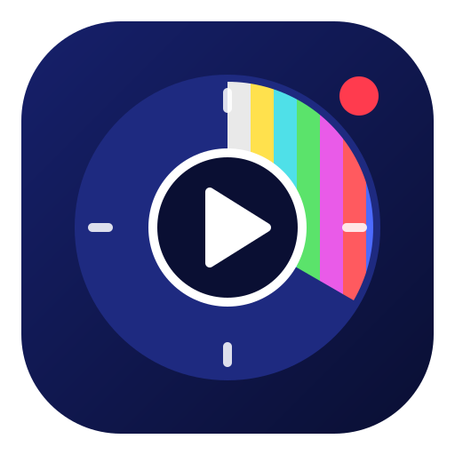</a>
</p>

<h1 align="center">Saturday Mornings</h1>

<p align="center"><b>Real TV for kids. It starts, it ends.</b><br>
<a href="https://saturdaymornings.tv">saturdaymornings.tv</a></p>

<p align="center">
  <a href="https://saturdaymornings.tv/?film">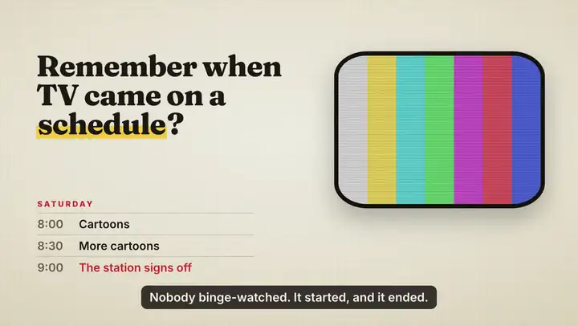</a><br>
  <a href="https://saturdaymornings.tv/?film"><b>Watch the full 90-second film, with sound</b></a>
</p>

Saturday Mornings gives each child their own TV channel of shows you choose,
on a real schedule. When it's time, the channel comes on by itself; when time's
up, the station signs off with colour bars and tells them when it's back.
There's no autoplay and no "up next" screen, and nobody has to argue about
turning it off, because the TV does it.

## On the TV

<table>
  <tr>
    <td width="50%">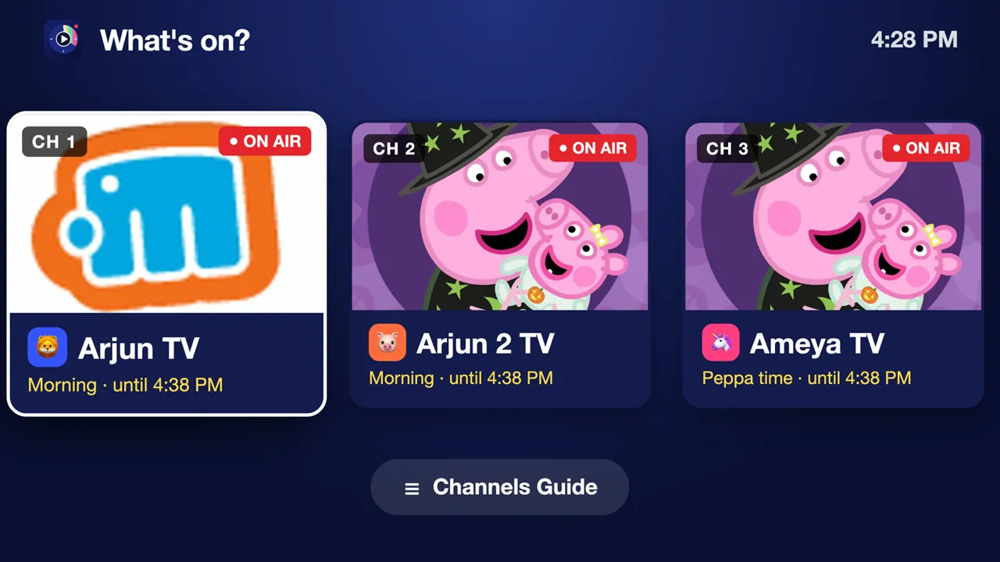<br>Each kid gets their own channel.</td>
    <td width="50%">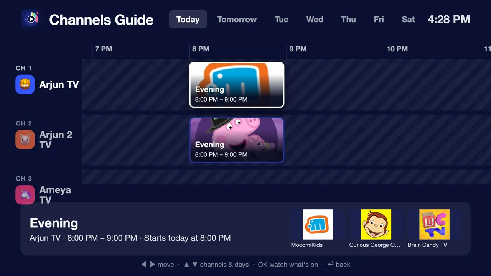<br>The Channels Guide shows what's on and when each channel is back.</td>
  </tr>
  <tr>
    <td>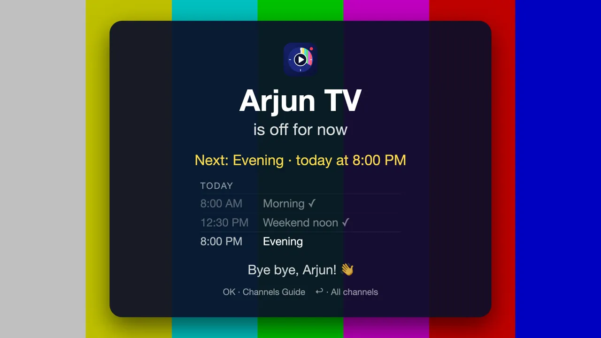<br>When time's up, the channel signs off and says when it returns.</td>
    <td>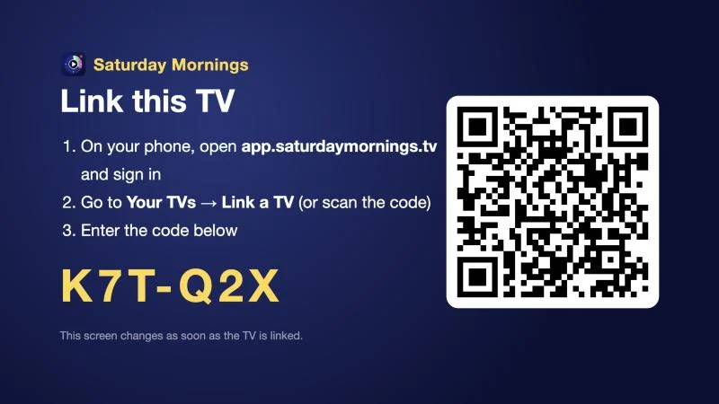<br>A TV links with a short code, just once.</td>
  </tr>
</table>

## On your phone

<table>
  <tr>
    <td width="25%">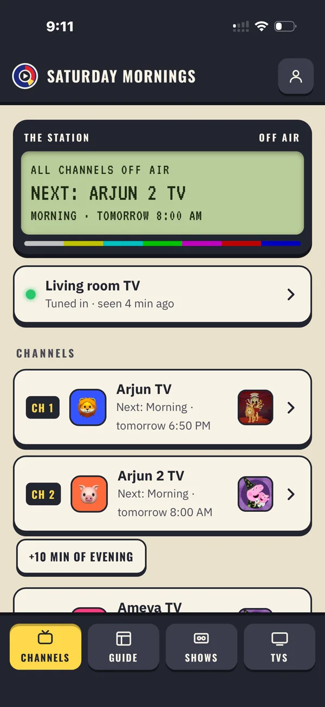<br>Every channel at a glance</td>
    <td width="25%">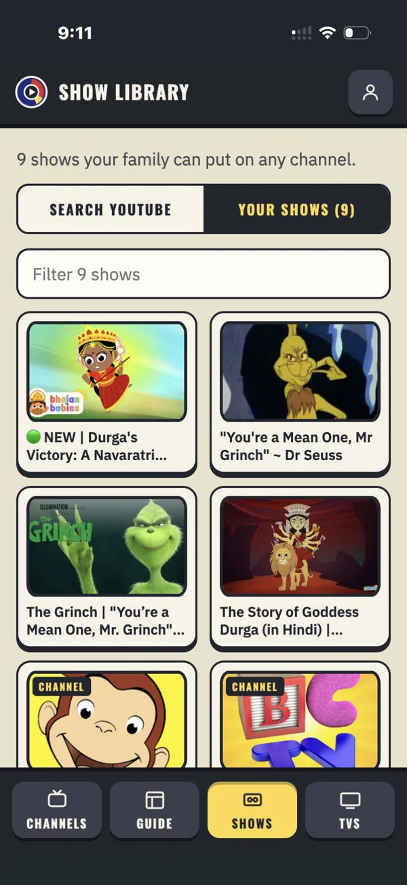<br>Your family's show library</td>
    <td width="25%">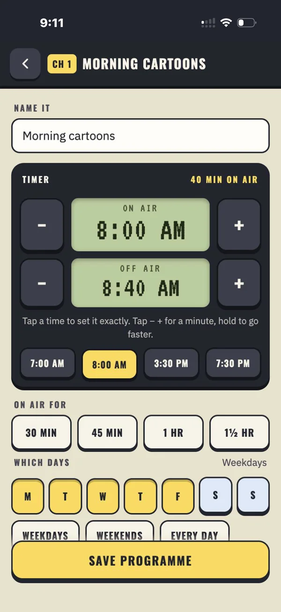<br>A VCR-style timer, to the minute</td>
    <td width="25%">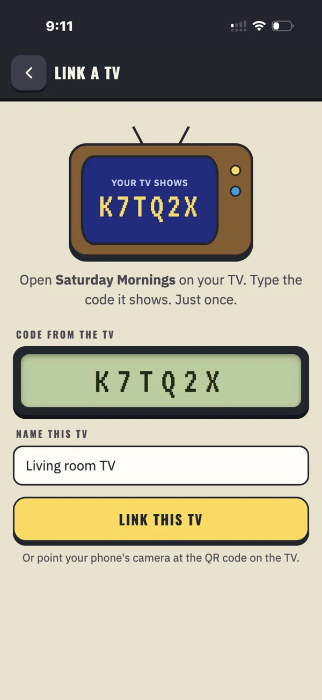<br>Type the code the TV shows</td>
  </tr>
</table>

<p align="center">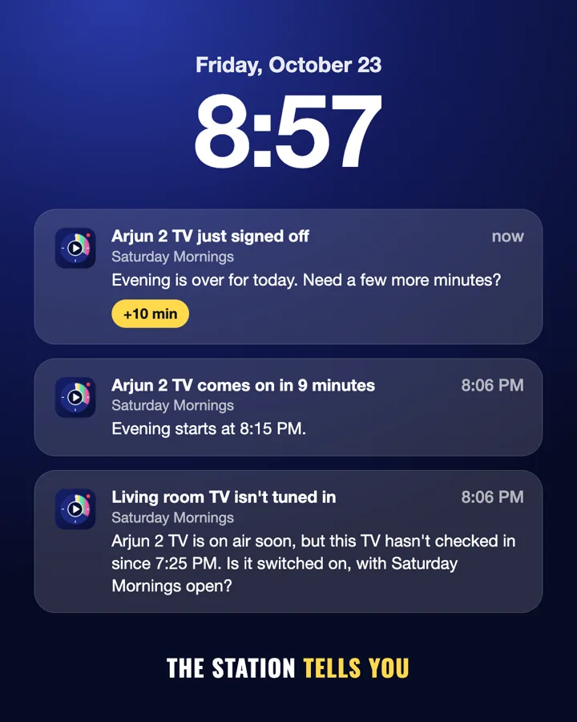<br>
The station tells you when a show is about to start, when a channel signs off
(with a "+10 min" button), and when a TV isn't tuned in.</p>

## Set it up

There are three illustrated step-by-step guides, as PDFs.

- **[Build your own station](docs/guides/build-your-own-station.pdf)** puts the parent app and server on your own free Cloudflare account, with every account and every command.
- **[Samsung TV, step by step](docs/guides/samsung-tv-step-by-step.pdf)** covers Tizen Studio, Developer Mode and your own certificate, then the build and install.
- **[Android TV, step by step](docs/guides/android-tv-step-by-step.pdf)** needs developer options, Android's free tools, one settings file and one script (tested on an NVIDIA Shield).

The same steps are in plain text in [docs/SELF-HOSTING.md](docs/SELF-HOSTING.md).

If you'd rather not tinker, the hosted edition at
[saturdaymornings.tv](https://saturdaymornings.tv) runs the station for you.

## What's in it

- **Parent app** (`apps/parent`) is an installable web app (PWA) for your phone. Give
  each kid a channel, pick shows from YouTube (channels, playlists or single
  videos), set programmes with a minute-exact timer, link TVs with a short
  code, and invite the other parent. Optional notifications cover a show coming on soon, a channel signing off (with a "+10 min" button), a TV not tuned in, and a schedule change.
- **TV app** (`apps/tv`) has the channel picker, a Channels Guide, the show
  itself and the sign-off screen, served by your station at `/tv/`. It follows
  the family's schedule in the family's time zone.
- **Samsung launcher** (`apps/tv-samsung`) is the Tizen app you install on the TV.
  It opens `/tv/` full screen.
- **Android TV / Google TV app** (`apps/android-tv`) does the same for
  Android TVs (tested on an NVIDIA Shield); `apps/android-tv/build.sh` builds
  and installs it.
- **Shared** (`shared/`) holds the schedule logic and logo every app uses.
- **Server** (`cloud/`) is one Cloudflare Worker with a D1 database. It serves the
  parent app (`/app/`), sign-in (`/`), the TV app (`/tv/`) and the API. Sign-in
  is a passkey or a 6-digit email code; kids never have accounts.
- **Home-only mode** (`home-server/`) runs the same apps from one computer on your
  Wi-Fi, with no cloud account. It has no sign-in, so anyone on your network
  can change the schedule.

## Run it locally

```
cd cloud
npm install
printf 'DEV_ECHO_CODES=1\n' > .dev.vars   # sign-in codes appear on screen instead of by email
npm run dev                               # http://localhost:8787
```

You can also add `YOUTUBE_API_KEY` to `cloud/.dev.vars` for search and channel
links, and `node scripts/vapid.mjs --dev` adds a key for testing notifications.

To run home-only mode without a Cloudflare account, start it from the repository folder.

```
node home-server/server.js                # TV app at http://<this-computer-ip>:8790/, phone app at /setup/
```

Run the tests with `node test/schedule.test.js`.

## Settings

Everything about your station lives in `cloud/wrangler.jsonc` (`vars`) plus a
few secrets set with `npm run wrangler -- secret put`. Keep your real values in
a copy named `cloud/wrangler.local.jsonc`. Git ignores it, and every `npm run`
script uses it when it exists.

| Setting | What it's for |
|---|---|
| `APP_URL`, `SITE_URL` | Your station's address (links in emails) |
| `CONTACT_EMAIL` | Shown on the privacy and terms pages |
| `EMAIL_FROM`, `REPLY_TO` | Sender of sign-in codes (a domain verified in Resend) |
| `RP_ID` | Passkey domain (your domain, or leave empty) |
| `EARLY_ACCESS` | `"on"` lets only approved emails sign in, and everyone else joins a waiting list. Leave `"off"` for a family station |
| `ADMIN_EMAILS` | Who sees Account › Early access |
| `TURNSTILE_SITE_KEY` | Optional Cloudflare Turnstile bot check on sign-in |
| `MAX_TVS`, `MAX_PARENTS` | Optional family limits on TVs linked at once and on parents (invites included). `0` means no limit, the default |
| `OPERATOR_NAME`, `OPERATOR_ADDRESS` | Who runs the station, for the privacy, terms and security pages |
| Secrets | `CODE_PEPPER`, `RESEND_API_KEY`, `YOUTUBE_API_KEY`, optional `VAPID_PRIVATE_JWK` (notifications) and `TURNSTILE_SECRET` |

The privacy policy and terms in `cloud/web/` are the hosted edition's own.
Rewrite them for your station before you invite anyone.

## YouTube

Videos play in YouTube's own player. Only official endpoints are used (the
YouTube Data API and oEmbed). Households store YouTube IDs only; titles and
thumbnails are cached for at most 30 days and refreshed daily, as YouTube's
Developer Policies require.

## License

Saturday Mornings is **source available** under the
[PolyForm Noncommercial License 1.0.0](LICENSE). Families, schools, hobbyists
and charities are free to use, change and share it for any noncommercial
purpose. Commercial use is not allowed, so it can't be sold, resold or run as a
paid service.

The Saturday Mornings name and logo are not covered by the license.
